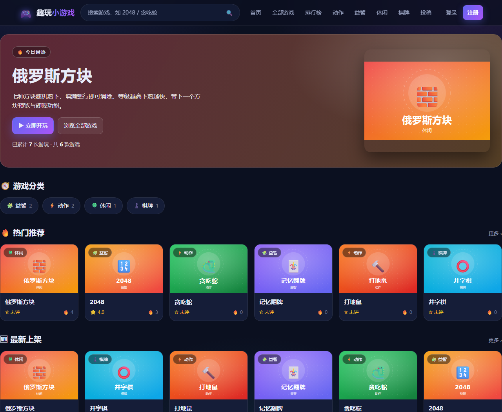

# 趣玩小游戏 · 类 4399 小游戏站原型

一个**开箱即跑**的在线小游戏聚合站最小原型：纯 HTML + Express 服务端渲染 + `node:sqlite` 存元数据。
零前端框架、零构建步骤、零图片文件（封面是运行时生成的 SVG），`pnpm install` 后一条命令即可访问。
自带完整的账号体系（注册登录、收藏、评论）与站长后台（投稿审核、上下架、评论管理），全部落在本地 SQLite，不依赖任何外部服务。



## 功能一览

| 模块 | 说明 |
| --- | --- |
| 首页 | Hero（今日最热）、游戏分类、热门推荐、最新上架 |
| 游戏库 | 分类页 `/category/:slug`、标签页 `/tag/:tag`、全部游戏 `/games`，支持 `sort=hot\|new\|rating\|title` |
| 搜索 | `/search?q=` 与 `/games?q=`，按标题/副标题/描述/标签模糊匹配（已转义 LIKE 通配符） |
| 详情页 | 玩家信息 + 相关推荐 + 操作提示 + 游玩次数 + 5 星评分 + 收藏 + 玩家评论 |
| 播放器 | iframe `sandbox` 隔离 + 全屏 + 真·重开 + 新窗口打开 |
| 6 款自研游戏 | 2048、贪吃蛇、记忆翻牌、打地鼠、井字棋（minimax AI）、俄罗斯方块 |
| 账号 | 注册 / 登录 / 退出；`scrypt` 加盐哈希存口令，`HttpOnly` 会话 cookie，30 天有效 |
| 收藏 | 详情页一键「♡ 收藏」，`/favorites` 我的收藏夹 |
| 评论 | 详情页发评论（≤500 字，同一用户同一游戏 10 秒限流），站长可隐藏 / 恢复 |
| 投稿与后台 | `/submit` 登录后投稿进待审队列；`/admin` 站长审核上架、上下架游戏、管理评论 |
| 评分 | 登录后 5 星打分，一人一票、随时改票；均值实时回写数据库（未登录只能看，点星会引导去登录） |
| SEO | 每页独立 title/description/canonical/OG、JSON-LD（WebSite / CollectionPage / VideoGame，有人评分时才带 AggregateRating）、`/sitemap.xml`、`/robots.txt`；登录/注册/收藏/投稿/后台一律 `noindex` |
| 统计 | `POST /api/games/:slug/play`，同一 IP + 同一游戏 30 秒内去重 |
| 封面 | `/cover/:slug.svg` 按游戏的配色 + emoji 动态生成，无需任何图片素材 |

## 环境要求

- **Node.js >= 22.5**（用到内置 `node:sqlite`，需要 `--experimental-sqlite` 以下的新版本能力）
- pnpm 或 npm 任选其一

> 本机如果 `node` 不在 PATH 里，可以直接用 DSH 捆绑运行时：
>
> ```powershell
> $NODE = "C:\Users\Administrator\.dsh\dsh-runtimes\dsh-primary-runtime\dependencies\node\bin\node.exe"
> $PNPM = "C:\Users\Administrator\.dsh\dsh-runtimes\dsh-primary-runtime\dependencies\pnpm\bin\pnpm.mjs"
> & $NODE $PNPM install --registry=https://registry.npmmirror.com
> & $NODE server.js
> ```

## 快速开始

```bash
pnpm install --registry=https://registry.npmmirror.com   # 国内网络走镜像源
pnpm start                                               # 或 pnpm dev（--watch 热重启）
```

打开 <http://localhost:3000>。首次启动会自动建表、灌入 4 个分类 + 6 款游戏，并创建默认站长账号。

> **默认管理员**：`admin` / `admin123`（用户名显示为「站长」）。
> 上线前务必用环境变量改掉：`ADMIN_USER=you ADMIN_PASS=一串强口令 pnpm start`。
> 只要还是默认口令，服务启动时就会打印一行 ⚠️ 警告。

> 种子数据**不灌任何假数字**：所有游戏的游玩次数与评分都是 0，
> 没有票的时候页面显示「☆ 未评 / 还没有人评分」，而不是伪造一个 4.8 分。

想换端口：`PORT=8080 pnpm start`（PowerShell：`$env:PORT=8080; pnpm start`）。

想重置游戏数据：`pnpm reset`（等价于 `node src/seed.js --force`，清空 games / play_logs / ratings 后重灌种子，**不动账号**）。

想彻底回到出厂状态：停掉服务 → 删除 `data/games.db`（连同 `-wal` / `-shm`）→ 重新启动（账号、收藏、评论、投稿一起清空）。

想固定站点域名（影响 canonical / OG / sitemap）：`SITE_ORIGIN=https://example.com pnpm start`。

## 目录结构

```
game-site/
├── server.js            Express 入口：安全头、静态目录、页面路由、API、登录守卫
├── package.json         type: module，scripts: start / dev / reset / smoke / test:account / build:pages / serve:dist / smoke:pages / test:worker / serve:worker / test:worker-app
├── data/games.db        SQLite 数据库（首次启动自动生成）
├── src/
│   ├── db.js            数据库连接、PRAGMA、建表与索引
│   ├── auth.js          账号：scrypt 口令哈希、会话 cookie、注册校验、默认站长
│   ├── seed.js          分类与游戏的种子数据（node src/seed.js --force 可重置）
│   ├── data.js          所有查询：列表/详情/搜索/评分/收藏/评论/投稿/后台统计
│   ├── views.js         服务端字符串模板：首页/列表/详情/登录注册/收藏/投稿/后台/404
│   └── cover.js         动态生成封面 SVG 与 OG 图 SVG
├── public/
│   ├── css/style.css    全站样式（暗色玻璃拟态，响应式，含播放器与后台表格样式）
│   ├── js/app.js        搜索回填、游玩上报、评分、收藏、评论、全屏 / 重开（Express 版）
│   └── js/app-static.js 静态版前端：列表排序、前端搜索过滤、播放器全屏 / 重开
├── tools/
│   ├── browser-smoke.mjs  无头 Chrome 真实交互冒烟测试（零依赖，pnpm smoke）
│   ├── account-test.mjs   账号系统 57 项断言测试（pnpm test:account）
│   ├── build-pages.mjs    静态导出：GitHub Pages / Cloudflare Pages（pnpm build:pages）
│   ├── serve-dist.mjs     本地预览 dist（模拟子路径部署，pnpm serve:dist）
│   ├── pages-smoke.mjs    静态版无头 Chrome 冒烟 + 截图（pnpm smoke:pages）
│   ├── worker-test.mjs    Cloudflare Worker 离线自测：静态版 23 项 + html_handling 配置守卫（pnpm test:worker）
│   ├── d1-local.mjs       本机 D1 假实现：node:sqlite 冒充 D1（prepare/bind/first/all/run/batch）
│   ├── serve-worker.mjs   本机把 worker/app.js 跑起来（pnpm serve:worker，默认 :4400）
│   └── worker-app-test.mjs 一条命令跑 Worker + D1 的 57 项账号验收（pnpm test:worker-app）
├── worker/index.js      Cloudflare Workers 静态版入口：安全头 / 缓存 / 干净地址 / 404
├── worker/app.js        Workers + D1 完整版入口：路由 / 安全头 / 会话（复用 src/views.js）
├── worker/data.js       D1 版全部查询（异步版 src/data.js）
├── worker/auth.js       D1 版账号：PBKDF2 口令、会话表、默认站长
├── worker/schema.js     建表 + 灌种子 + 站长自举（首次请求时跑，幂等）
├── worker/seed-data.js  4 个分类 / 6 款游戏的种子（由 src/seed.js 生成）
├── wrangler.toml        Workers 静态版配置：[assets] 指向 dist-cf，绑定名 ASSETS
├── wrangler.d1.toml     Workers + D1 配置：多一个 [[d1_databases]] 绑定 DB
├── migrations/0001_init.sql  D1 建表脚本（由 worker/schema.js 的 DDL 生成）
├── dist/                静态版产物：GitHub Pages 用（--base=/仓库名/）
├── dist-cf/             静态版产物：Cloudflare Pages 用（--base=/，多一个 _headers）
├── cloudflare-pages.zip dist-cf 的 zip 包，Cloudflare 控制台可直接拖拽上传
├── docs/screens/        冒烟测试与手工验证产出的截图
├── DEPLOY-GITHUB-PAGES.md   静态版部署到 GitHub Pages 的步骤与各种坑
├── DEPLOY-CLOUDFLARE.md     部署到 Cloudflare Pages 的步骤（含 Tunnel 与 Workers 三条路）
├── DEPLOY-CLOUDFLARE-WORKERS.md   Workers + Static Assets 的部署步骤与取舍
├── DEPLOY-CLOUDFLARE-D1.md      Workers + D1 完整版（账号/评分/评论/后台）的部署步骤、限额与未验证项
└── games/<slug>/index.html   每个游戏一个自包含页面（内联 CSS/JS，支持触屏）
```

## 路由表

**页面**

| 方法 | 路径 | 说明 |
| --- | --- | --- |
| GET | `/` | 首页 |
| GET | `/games` | 全部游戏，支持 `?q= &category= &tag= &sort= &page=` |
| GET | `/category/:slug` | 分类页 |
| GET | `/tag/:tag` | 标签页 |
| GET | `/search` | 搜索结果页（`?q=`） |
| GET | `/game/:slug` | 游戏详情 + 播放器 + 评分 + 评论 |
| GET | `/games/:slug/index.html` | 游戏本体（静态目录，供 iframe 加载） |
| GET/POST | `/login` | 登录页 / 提交登录（失败 401 回显表单，支持 `?next=`） |
| GET/POST | `/register` | 注册页 / 提交注册（用户名重复 409） |
| POST | `/logout` | 退出登录，清掉会话 |
| GET | `/favorites` | 我的收藏夹（需登录） |
| GET/POST | `/submit` | 投稿表单 / 提交投稿（需登录，成功进待审队列） |
| GET | `/admin` | 站长后台：统计 + 待审投稿 + 游戏管理 + 最新评论（需 admin） |
| POST | `/admin/games/:slug/status` | 上架 / 下架 / 通过 / 拒绝（需 admin） |
| POST | `/admin/comments/:id/status` | 隐藏 / 恢复评论（需 admin） |
| GET | `/cover/:slug.svg` | 动态封面图 |
| GET | `/sitemap.xml` / `/robots.txt` / `/favicon.ico` | SEO 与图标（robots 屏蔽了 `/admin` `/login` `/register` `/favorites` `/submit`） |

**API**

| 方法 | 路径 | 说明 |
| --- | --- | --- |
| GET | `/api/games` | 列表，参数同上；返回 `{ total, limit, offset, items }` |
| GET | `/api/games/:slug` | 单个游戏详情 |
| POST | `/api/games/:slug/play` | 上报一次游玩，30 秒同 IP 去重，返回 `{ counted, plays }` |
| POST | `/api/games/:slug/rate` | 评分，**需登录**，body `{"stars": 1..5}`，返回 `{ stars, previous, isNew, rating, count }`；未登录 401、非法星级 400、游戏不存在 404 |
| GET | `/api/me` | 当前登录用户（未登录返回 `{ user: null }`） |
| POST | `/api/auth/login` | 登录，返回 `{ user }`；失败 401 `bad_credentials` |
| POST | `/api/auth/register` | 注册并登录，201 返回 `{ user }`；重名 409 `taken` |
| POST | `/api/auth/logout` | 退出，返回 `{ ok: true }` |
| POST | `/api/games/:slug/favorite` | 收藏 / 取消收藏（需登录），返回 `{ favorited, count }` |
| POST | `/api/games/:slug/comments` | 发评论（需登录），body `{"body": "..."}`，返回 `{ id, body, name }`；空白 400 `empty`、超长 400 `too_long`、10 秒内连发 429 `too_fast` |

## 怎么加一个新游戏

1. 新建 `games/<slug>/index.html`，写一个**自包含**的单页游戏（**不要引用外部资源**，方便以后搬到独立域名）。
2. 在 `src/seed.js` 的 `GAMES` 数组里加一条：

```js
{
  slug: 'my-game',
  title: '我的游戏',
  subtitle: '一句话卖点',
  description: '详情页展示的玩法说明。',
  category: 'puzzle',              // 对应 CATEGORIES 里的 slug
  game_url: '/games/my-game/index.html',
  width: 480, height: 720,         // 播放器按这个比例留白
  orientation: 'portrait',         // portrait | landscape
  tags: ['益智', '休闲'],
  emoji: '🎯',
  accent: '#6366f1', accent2: '#a855f7',   // 封面渐变色 + 卡片配色
  license: '自研'          // plays / rating 不要写死，由真实游玩与评分累加
}
```

3. `pnpm reset` 重新灌种子（或删掉 `data/games.db` 后重启），刷新页面即可看到。

> 列表页的排序、搜索、标签聚合、sitemap、封面图全部由数据驱动，不需要改模板。
> 也可以直接注册一个账号走 `/submit` 投稿：填完进待审队列，站长在 `/admin` 点「✅ 通过上架」就公开了。

## 数据模型

```sql
categories(id, slug, name, icon, sort)
games(id, slug, title, subtitle, description, category_id, engine,
      game_url, width, height, orientation, tags /* JSON 字符串 */,
      emoji, accent, accent2, plays, rating, rating_count, license,
      status /* 1 已上架 / 0 已下架 / 2 待审核 */, submitted_by, created_at)
play_logs(id, game_id, day, created_at)   -- 按天统计游玩趋势
ratings(id, game_id, visitor, stars, created_at, updated_at)
      -- UNIQUE(game_id, visitor)：一人一票，可改票；visitor 存登录用户 id 的字符串
      -- CHECK(stars BETWEEN 1 AND 5)；game_id 外键 ON DELETE CASCADE
users(id, username UNIQUE, display_name, pass_hash, pass_salt, role, created_at)
      -- role: user | admin；pass_hash 是 scrypt(password, salt) 的 64 字节 hex
sessions(id, token UNIQUE, user_id, created_at, expires_at)
      -- token 是 randomBytes(32) 的 hex，user_id 外键 ON DELETE CASCADE
favorites(user_id, game_id, created_at)   -- PRIMARY KEY(user_id, game_id)
comments(id, game_id, user_id, body, status, created_at)
      -- status 1 显示 / 0 隐藏；JOIN users 取昵称
```

已建索引：`idx_games_cat`、`idx_games_plays`、`idx_logs_game`、`idx_logs_day`、`idx_ratings_game`、`idx_sessions_user`、`idx_fav_user`、`idx_comments_game`。
数据库开启了 WAL 与 `foreign_keys=ON`。

**评分是怎么算的**：写票用 SQLite 的 UPSERT
（`INSERT ... ON CONFLICT(game_id, visitor) DO UPDATE SET stars = excluded.stars`），
写完立刻 `SELECT COUNT(*), AVG(stars)` 重算，把均值（保留 1 位小数）和票数**回写到 games 表**，
这样列表页排序（`sort=rating`）和 JSON-LD 都只需要读 games 一个表。

**登录与会话**：口令用 `node:crypto` 的 `scryptSync` 加盐哈希成 64 字节 hex，比对走 `timingSafeEqual`。
登录成功后往 `sessions` 插一条 `randomBytes(32)` 的 token，通过 `sid` cookie（`HttpOnly; SameSite=Lax; Max-Age=30 天）`下发；
每个请求先按 `/^[a-f0-9]{64}$/` 校验格式再查库、看是否过期，得到 `req.user`。
用户不存在时也会跑一次哈希，避免用响应时间探测哪个用户名存在。

**投稿与上架**：新投稿写进 `games` 但 `status=2` 且记下 `submitted_by`，
公开列表（首页/分类/搜索/API）只查 `status=1`，所以待审与已下架的投稿不会漏出来；
站长在后台改 `status`（`2 → 1` 通过、`2 → 0` 拒绝、`1 → 0` 下架、`0 → 1` 重新上架）。

## 安全设计

- **游戏全部在 iframe 沙箱里跑**：`sandbox="allow-scripts allow-same-origin allow-pointer-lock allow-orientation-lock allow-popups"`，刻意**不给** `allow-top-navigation`，恶意/第三方游戏无法把整站跳走。
- 全站安全头：`X-Content-Type-Options`、`Referrer-Policy`、`X-Frame-Options`、`Permissions-Policy`，以及一条 CSP（因为自研游戏用了内联脚本，放行了 `unsafe-inline`/`unsafe-eval`/`blob:`）。
- 所有模板输出都过 `esc()` 转义，SQL 查询全部使用参数绑定，LIKE 通配符已转义；评论正文在写库前折叠空白并限长 500。
- 口令只存 scrypt 哈希（不存明文、不存可逆加密），接口返回的 user 只带 id / 用户名 / 昵称 / 角色。
- 会话 cookie 是 `HttpOnly` + `SameSite=Lax`：脚本读不到，跨站表单 POST 也带不上；
  加上登录/收藏/评论都走同源 POST，CSRF 风险被这两层压住（真要更严可以再加一次性 token）。
- 跳转参数走白名单 `safeNext()`，`?next=//evil.com`、`?next=https://evil.com` 一律改写成 `/`，挡掉开放重定向。
- 受限接口都有守卫：`requireLogin`（页面 302 去登录、接口 401）与 `requireAdmin`（非站长 302 / 403）。

> **上线前必做**：把游戏资源挪到**独立域名**（例如 `games.example.com`），详情页 iframe 指向该域名，并把 `allow-same-origin` 去掉——这样才能真正隔离第三方游戏，防止它读到主站 cookie。
> 另外记得改掉默认管理员口令，并在前面挂 HTTPS。
> 接了 Cloudflare 之后，源站要读 `CF-Connecting-IP` / `X-Forwarded-For` 才能拿到真实访客 IP（现在的去重逻辑用的是 `req.ip`）。

## 部署（Cloudflare 路线）

1. 主站：Node 进程放 VPS，或把渲染层改造成 Serverless（Cloudflare Workers + Hono 等），前面挂 Cloudflare 橙云代理，SSL/TLS 用 **Full (Strict)**。
2. 游戏资源：`games/*` 传 R2 / OSS，走 CDN，用独立域名承载。
3. 数据库：SQLite 单机够用；要上云就换 PostgreSQL 或 Cloudflare D1，`src/data.js` 是唯一需要改的层。
4. `SITE_ORIGIN` 设成正式域名，sitemap / canonical / OG 才会输出正确链接。
5. 国内服务器需 ICP 备案；`robots.txt` 与 sitemap 交给搜索引擎收录是这类站点的主要流量来源。

## 静态版（部署到 GitHub Pages）

GitHub Pages 只能托管静态文件，所以另做了一条导出路线：把服务端渲染结果全部预渲染成 HTML，并把根绝对链接改写成带仓库前缀的静态文件路径（`/game/2048` → `/仓库名/game/2048.html`）。

```bash
node tools/build-pages.mjs --base=/仓库名/ --origin=https://用户名.github.io/仓库名
node tools/serve-dist.mjs --base=/仓库名/ --port=4173   # 本地预览（模拟子路径部署）
node tools/pages-smoke.mjs --base=/仓库名/              # 无头 Chrome 冒烟 + 截图
```

静态版保留：首页、分类、标签、搜索（前端过滤）、列表排序（前端排序）、详情页、iframe 播放器（全屏 / 重开）、6 款游戏本体。
静态版隐藏：登录注册、评分、评论、收藏、投稿、站长后台、游玩次数（详情页换成一句"静态演示版"说明）。

参数含义、发布步骤、`.nojekyll` 与中文文件名等坑，见 **[DEPLOY-GITHUB-PAGES.md](DEPLOY-GITHUB-PAGES.md)**。

## 静态版（部署到 Cloudflare Pages）

同一份代码换个前缀就是 Cloudflare 版：Pages 默认挂在域名根（`https://项目名.pages.dev/`），所以 `--base=/`，并多输出一个 Cloudflare 专属的 `_headers`（安全响应头 + 静态资源分级缓存）。

```bash
node tools/build-pages.mjs --cf --base=/ --origin=https://项目名.pages.dev --out=dist-cf
node tools/pages-smoke.mjs --base=/ --out=dist-cf      # 无头 Chrome 冒烟 + 截图
```

产物 `dist-cf/`（48 个文件）已打包成 **`cloudflare-pages.zip`**，在 Cloudflare 控制台 *Workers & Pages → Create → Pages → Upload assets* 里拖上去即可，不用装 wrangler、不用 Git。三条发布路线（控制台上传 / Git 集成 / wrangler）、自定义域名后的重建、`_redirects` 漂亮地址、以及想挂**有服务端**的完整版时走 Cloudflare Tunnel 的完整命令，见 **[DEPLOY-CLOUDFLARE.md](DEPLOY-CLOUDFLARE.md)**。

> 本机（开发环境）没有外网出口也没有 Cloudflare 凭证，最后一步上传需要你自己在浏览器里完成；`dist-cf/` 与 zip 都已经构建并本地验证过。

## 静态版（部署到 Cloudflare Workers）

同一份 `dist-cf/` 也可以挂到 **Workers + Static Assets** 上，前面多一个 Worker，于是能注入安全响应头（Workers 不认 Pages 的 `_headers`）、控制缓存、并把 `/games`、`/game/2048` 这种干净地址映射到对应的 `.html`。

```bash
node tools/build-pages.mjs --cf --base=/ --origin=https://game-site.<账号>.workers.dev --out=dist-cf
wrangler deploy                 # 读取 wrangler.toml，把 dist-cf 作为静态资源一起上传
node tools/worker-test.mjs      # 没有 wrangler / 没有网络时的离线自测（pnpm test:worker）
```

这个 Worker 只负责发静态站。想要账号、评分、评论、收藏、后台，用下面的 **[完整版（Workers + D1）](#完整版部署到-cloudflare-workers--d1)**。

## 完整版（部署到 Cloudflare Workers + D1）

纯静态版没有服务端，账号、评分、评论、收藏、投稿、后台都不在。把 `worker/app.js` + **Cloudflare D1**（托管 SQLite）配上，就能把这些功能整体搬到边缘：模板仍是同一个 `src/views.js`，账号验收测试也是同一套 `tools/account-test.mjs`。

```bash
node tools/build-pages.mjs --cf --base=/ --origin=https://你的域名 --out=dist-cf
wrangler d1 create game-site-db                  # 把返回的 database_id 填进 wrangler.d1.toml
wrangler d1 migrations apply game-site-db --remote
wrangler deploy --config wrangler.d1.toml
```

本机不需要 Cloudflare 账号、不需要外网也能验证（Node 22 的 `node:sqlite` 冒充 D1，见 `tools/d1-local.mjs`）：

```bash
node tools/serve-worker.mjs --reset    # http://127.0.0.1:4400（pnpm serve:worker）
node tools/worker-app-test.mjs         # 一条命令跑 57 项账号验收（pnpm test:worker-app）
node tools/browser-smoke.mjs           # 另开终端，BASE=http://127.0.0.1:4400
```

完整步骤（建库、绑自定义域名、改默认站长密码、备份与重置、排错），以及**我没能在本机验证的部分**（需要账号的 `wrangler login` / `wrangler deploy`、真实 Workers 上 PBKDF2 的 CPU 时间、D1 限额）都写在 **[DEPLOY-CLOUDFLARE-D1.md](DEPLOY-CLOUDFLARE-D1.md)**；`wrangler dev`（真 workerd）后来已经在本机跑通，命令见 **[DEPLOY-CLOUDFLARE-WORKERS.md](DEPLOY-CLOUDFLARE-WORKERS.md)** 文末。

## 已验证

- 全部页面 / API 路由返回 200，不存在的游戏与路径正确返回 404。
- 6 款游戏均在无头 Chrome 中**真实交互**通过：2048 合出分数、贪吃蛇可转向移动、俄罗斯方块开始后消行计分、记忆翻牌连配 2 对、打地鼠命中计分、井字棋人机交替落子。
- 页面无 console 报错、无 404 资源。
- 账号系统 `pnpm test:account` 共 **57 项断言全部通过**：
  游客评分/收藏/评论一律 401、未登录访问 `/submit` 与 `/admin` 跳登录页、
  注册 201 且重名 409 / 非法用户名 400 / 短密码 400、错密码 401 文案统一、
  首评建票、同一人改票票数不涨、非法星数 400、详情页按登录态渲染可点或只读星级、
  收藏来回切换计数正确、`/favorites` 列出收藏、收藏不存在的游戏 404、
  评论空白折叠、空评论 400、超长 400、10 秒内连发 429、
  投稿成功返回编号、非法游戏地址被拒、待审不出现在列表、普通用户改状态 403、
  站长审核上架后出现在列表与详情页、下架后从列表消失、隐藏评论后游客看不到、
  退出后 `/api/me` 归 null、开放重定向被改写成 `/`。
- 静态版 `pnpm smoke:pages` 共 **9 个页面全部通过**（无 console 报错、无资源 404）：
  首页 12 张卡片且无投稿入口、列表页按名称排序真的重排、搜索 `?q=2048` 过滤成 1 张卡、标签页、
  详情页确认收藏按钮 / 评论区 / 可点星级 / 游玩次数都不渲染且 iframe 地址带前缀、
  **在详情页 iframe 里按键真的把 2048 从 0 玩到 16 分**、俄罗斯方块本体可玩、404 页、390x844 手机端无横向溢出。
  截图：`docs/screens/pages-home.png`、`pages-list.png`、`pages-search.png`、`pages-tag.png`、`pages-detail.png`、`pages-play.png`、`pages-game-tetris.png`、`pages-404.png`、`pages-mobile.png`。
- Cloudflare 版产物 `pnpm smoke:pages` 同样 **9 个页面全部通过**（`--base=/ --out=dist-cf`），GitHub 版与 Cloudflare 版两份产物分别构建、分别冒烟。
- Workers 版 `pnpm test:worker` **23 项断言全部通过**：安全响应头与 `server.js:24-45` 逐字段一致、`/static/*` 7 天 / `/cover/*` 1 天 / `/games/*` 1 小时 / HTML 不缓存的缓存策略、`/games` 与 `/game/2048` 干净地址、`/favicon.ico` 302、非 GET 405、404 带 noindex、路径穿越不外泄、「静态路径不产生任何跳转」（防 `html_handling` 配错导致重定向死循环）、外加 8 个页面 **53 条站内链接全部 200**。
- Workers + D1 完整版 `pnpm test:worker-app` **57 项账号断言全部通过**（复用 Express 版同一套 `tools/account-test.mjs`），并用 `pnpm smoke` 对 `http://127.0.0.1:4400` 跑了 **14 个页面全过**（含 6 款游戏真操作、后台、收藏、投稿），无 console 报错、无资源 404；出厂态复核：首页 12 张「☆ 未评」、`<b>0</b> 次游玩`、详情页「还没有人评分」且无 `aggregateRating`。
- 两套 Workers 产物都在**真实 workerd** 上复验过（`wrangler dev`，wrangler 4.151.0）：静态版逐路径实测无跳转、安全头与缓存头正确；Workers + D1 版逐页面 200、`/favorites` 与 `/admin` 未登录正确 302 到登录，`account-test.mjs` 在真 workerd + 真 D1 语义下 **57 项断言全过**。
  这一步捞出并修掉了两个只有真运行时才暴露的问题：`html_handling` 配成 `auto-trailing-slash` 会让站点陷入 `ERR_TOO_MANY_REDIRECTS`；真实 D1 的 `exec()` 按换行切语句，导致多行建表 SQL 直接 500。细节见两份 Cloudflare 部署文档。
- 后台与账号相关的页面在无头 Chrome 里截图确认过：`docs/screens/login.png`、`register.png`、`submit.png`、`admin.png`、`favorites.png`、`rating.png`。
  > `pnpm smoke` 会用默认管理员真登录一次，并给 2048 留一条评分与一条收藏记录；
  > `pnpm test:account` 会留下 tester1 / tester2 两个账号和一条待审投稿。跑完想干净就按上面「彻底回到出厂状态」删库重启。

## 后续可做

- Redis 排行榜（`ZINCRBY` / `ZREVRANGE`）替换现在的 `plays` 计数。
- Meilisearch 替换 LIKE 搜索，支持拼音/错字/相关度排序。
- 评论分页与楼中楼回复、@提醒、举报入口。
- 后台上再加投稿详情预览、批量上下架、操作日志，以及封禁用户。
- 邮箱验证、找回密码、第三方（GitHub / 微信）登录。
- 图片/视频素材、真实 OG 截图。
